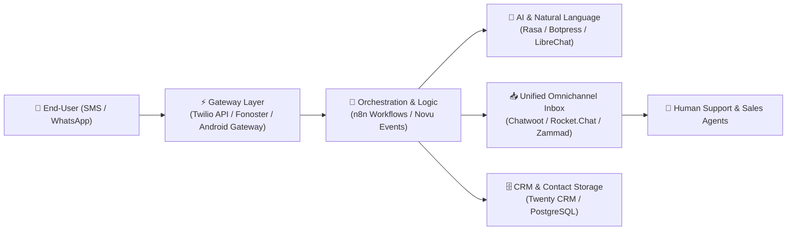

  

# 💬 Awesome Conversational SMS & Messaging

### 🚀 Top Conversational SMS, Omnichannel Inboxes, A2P Messaging & Business Telephony Ecosystem

**Curated List of Enterprise SaaS Products & Self-Hosted Open-Source GitHub Projects**  
*Focused on Two-Way SMS, Omnichannel Customer Inboxes, RCS, WhatsApp Business & Telephony Gateways*

---

## 📖 Introduction & Ecosystem Overview

Welcome to **Awesome Conversational SMS & Messaging**! This directory curates category-defining **SaaS platforms** and production-grade **open-source repositories** designed for modern **Conversational SMS & Business Messaging**. 

These tools empower growth teams, customer experience (CX) professionals, and software engineers to facilitate interactive, two-way mobile communications over SMS, MMS, RCS, WhatsApp Business, and webchat — accelerating sales pipelines, automating appointment scheduling, delivering real-time alerts, and orchestrating customer support workflows at global scale.

---

## 📑 Table of Contents

- [📊 Sector Overview & Market Dynamics](#-sector-overview--market-dynamics)
- [☁️ SaaS / Hosted Platforms](#️-saas--hosted-platforms)
- [🛠️ Open-Source GitHub Projects](#️-open-source-github-projects)
- [🏗️ Architectural Blueprints for Custom Stacks](#️-architectural-blueprints-for-custom-stacks)
- [📈 Star History](#--star-history)
- [🤝 How to Contribute](#-how-to-contribute)
- [💖 Support & Sponsoring](#-support--sponsoring)
- [⚖️ Regulatory Compliance & Disclaimer](#️-regulatory-compliance--disclaimer)

---

## 📊 Sector Overview & Market Dynamics

The global conversational messaging and Application-to-Person (A2P) SMS sector represents a combined market size estimated between **$68 billion and $90 billion** (comprising a ~$54B–$77B global A2P/CPaaS infrastructure layer and an expanding ~$16B conversational SMS marketing and engagement software market expanding at 5–8% CAGR through 2030).

Market dynamics show the industry is **moderately fragmented across software application layers with high concentration at the underlying CPaaS and hyperscale telco carrier tier**. While core carrier infrastructure and cloud APIs exhibit oligopolistic characteristics dominated by category giants like Twilio and Sinch, the conversational software layer remains vibrant and competitive — characterized by specialized vertical platforms (e-commerce SMS, local business engagement, healthcare communication) alongside modular, privacy-preserving open-source self-hosted alternatives.

---

## ☁️ SaaS / Hosted Platforms

The following SaaS solutions are sorted in descending order by company scale (market valuation / annual revenue run-rate):

| SaaS Product | Scale (Valuation / Revenue) | Pricing (Specific Starting Tier) | Free Tier Limits / Free Trial Details | Core Focus & Features |
| :--- | :--- | :--- | :--- | :--- |
| **[Salesforce Live Message](https://www.salesforce.com/)** | ~$310B Market Cap (~$38B Annual Revenue) | **$75 / user / month** (Digital Engagement add-on for Service Cloud; billed annually) | No permanent free tier; **30-day free trial** available via base Salesforce Service Cloud (guided walkthrough/demo required for messaging add-on) | Native enterprise CRM messaging enabling two-way SMS, WhatsApp, and Facebook Messenger inside Service Cloud with Einstein AI automation. |
| **[Twilio Messaging](https://www.twilio.com/messaging)** | ~$12B Market Cap (~$4.3B Annual Revenue) | **$0.0083 / SMS segment** (Pay-as-you-go starting tier; carrier pass-through fees apply) | **30-day free trial**; includes **100 free SMS messages**, 100 WhatsApp messages, 75 voice minutes, and 3,000 emails to up to 5 verified recipient numbers | Category-leading CPaaS API platform offering global SMS, MMS, RCS, and WhatsApp routing, intelligent delivery, and programmable webhooks. |
| **[Klaviyo SMS](https://www.klaviyo.com/)** | ~$7B Market Cap (~$900M Annual Revenue) | **$15 / month** (Includes 1,250 mobile credits; scales with active profile tiers) | **Free Forever Plan**; includes **$5/month mobile messaging credits** (approx. 150–300 SMS depending on destination), capped at 250 contact profiles & 500 emails/month | E-commerce SMS and marketing automation natively connected to customer data platform (CDP), predictive segmentation, and revenue attribution. |
| **[Podium](https://www.podium.com/)** | ~$3B Valuation (Private; ~$200M+ ARR) | **$399 / month** (Core Plan; up to 4 user seats, ~250 bulk marketing messages/month, annual contract) | No permanent free tier; **14-day trial / guided sandbox pilot** available upon request via sales demo | Lead conversion, two-way business texting, review solicitation, webchat-to-text, and mobile payment processing tailored for local service businesses. |
| **[Attentive](https://www.attentive.com/)** | ~$7B Peak Valuation (Private; ~$300M+ ARR) | **$2,000 / quarter minimum commitment** (~$0.010–$0.025 / SMS segment + volume platform fee) | No permanent free tier; **30-day free trial** available for qualifying brands via Shopify App Store / sales partner onboarding | Enterprise conversational mobile marketing driving personalized two-way campaigns, AI-assisted conversational flows, and automated cart abandonment recovery. |
| **[Birdeye](https://birdeye.com/)** | ~$1B Valuation (Private; ~$150M ARR) | **$299 / month / location** (Starter Plan; billed annually) | No permanent free tier; **30-day free trial** for specific AI modules (Reviews AI & Social AI) with zero credit card required; full messaging demo upon consultation | Omnichannel messaging inbox, automated review generation, two-way customer communication, and webchat routing for multi-location enterprises. |
| **[EZ Texting](https://www.eztexting.com/)** | ~$500M Valuation (Private; ~$60M ARR) | **$25 / month** (Launch Plan; includes 500 monthly messaging credits; $20/month if billed annually) | No permanent free tier; **14-day free trial** with **120 free messaging credits** and 1 dedicated text number (no credit card required) | SMB bulk texting, auto-replies, keyword signups, 10DLC compliance management, and team shared inboxes for conversational customer engagement. |
| **[SimpleTexting](https://simpletexting.com/)** | Subsidiary of Sinch ($2.5B Market Cap parent; ~$40M ARR unit) | **$29 / month** (Starting tier with 500 outgoing credits; incoming SMS messages are completely free) | No permanent free tier; **14-day free trial** with **50 free outgoing messages**, test phone number, and full platform feature access (no credit card required) | Web-based two-way conversational texting, mass notification campaigns, scheduled drip sequences, multimedia messaging, and CRM integrations. |
| **[SlickText](https://www.slicktext.com/)** | ~$150M Valuation (Private; ~$30M ARR) | **$29 / month** (Basic Plan; includes 500 monthly text credits and 2 custom keywords) | No permanent free tier; **14-day free trial** with **50 free message credits** and complete feature access (no credit card required) | Interactive SMS marketing platform with 1-on-1 two-way chat, recurring drip campaigns, automated opt-in keywords, and automated workflows. |
| **[SMS Magic](https://www.sms-magic.com/)** | ~$50M Valuation (Private; ~$15M ARR) | **$50 / month** (Automation Messaging tier; Conversational plan starts at $100/month or ~$15/user/month) | No permanent free tier; **14-day free trial** with complimentary trial messaging credits and test CRM connection | Multi-channel conversational texting natively embedded within Salesforce, HubSpot, and Zoho CRM environments for enterprise sales and support. |

---

## 🛠️ Open-Source GitHub Projects

The following self-hosted and open-source messaging platforms are ranked in descending order by current **GitHub Stars** ⭐:

| Open-Source Project | GitHub Community Rating | License | Technology Stack | Architecture & Messaging Capabilities |
| :--- | :--- | :--- | :--- | :--- |
| **[n8n](https://github.com/n8n-io/n8n)** |  | Fair-code (Sustainable Use) | TypeScript / Node.js / Vue | Fair-code workflow automation engine with prebuilt nodes for Twilio, Vonage, Infobip, WhatsApp, and webhook connectors for complete bidirectional SMS conversational logic. |
| **[Twenty](https://github.com/twentyhq/twenty)** |  | AGPL-3.0 | TypeScript / NestJS / React | Modern open-source CRM alternative to Salesforce. Extensible messaging integrations allow attaching two-way customer SMS and WhatsApp conversations directly to contact timelines. |
| **[Rocket.Chat](https://github.com/RocketChat/Rocket.Chat)** |  | MIT / Commercial | TypeScript / Node.js / React | Enterprise communication hub featuring a unified omnichannel agent inbox. Integrates SMS (via Twilio, Voxtelesys), WhatsApp, and live chat with SLA routing and bot handoff. |
| **[LibreChat](https://github.com/LibreChat-AI/LibreChat)** |  | MIT | TypeScript / Node.js / React | Enhanced open-source AI conversational platform supporting multi-model AI agents, extensible messaging endpoints, custom plugins, and bidirectional conversational automation. |
| **[Novu](https://github.com/novuhq/novu)** |  | MIT | TypeScript / NestJS / React | Open-source notification infrastructure enabling unified orchestration across SMS (Twilio, AWS SNS, MessageBird, Telnyx), push, chat, and email with fallback routing. |
| **[Chatwoot](https://github.com/chatwoot/chatwoot)** |  | MIT | Ruby on Rails / Vue.js | Leading self-hosted omnichannel customer engagement platform. Features dedicated two-way SMS inboxes via Twilio, Bandwidth, and custom HTTP webhooks with automated canned responses. |
| **[Rasa](https://github.com/RasaHQ/rasa)** |  | Apache-2.0 | Python / PyTorch | Industrial-grade conversational AI framework for building contextual voice and text assistants. Features natural language understanding (NLU), dialogue management, and SMS connectors. |
| **[Botpress](https://github.com/botpress/botpress)** |  | AGPL-3.0 | TypeScript / Node.js / React | Developer-focused conversational AI engine with visual flow builder, NLU, and multi-channel connectors for deploying automated SMS and WhatsApp conversational bots. |
| **[Baileys](https://github.com/WhiskeySockets/Baileys)** |  | MIT | TypeScript / WebSocket | High-performance, lightweight TypeScript library for interacting directly with WhatsApp Web Multi-Device API without requiring Selenium or headful browsers. |
| **[Typebot](https://github.com/baptisteArno/typebot.io)** |  | AGPL-3.0 | TypeScript / Next.js / Prisma | Visual conversational flow builder. Allows designing interactive forms and bots that seamlessly embed into mobile chat, WhatsApp, and SMS landing workflows. |
| **[Evolution API](https://github.com/evolution-foundation/evolution-api)** |  | Apache-2.0 | TypeScript / Node.js | Microservice API bridge for multi-device messaging channels (WhatsApp, Typebot, Chatwoot, and Dify integrations) enabling automated two-way conversational dispatch. |
| **[Fonoster](https://github.com/fonoster/fonoster)** |  | MIT | TypeScript / Node.js / Go | Open-source alternative to Twilio (CPaaS). Allows building programmable voice, SMS, and messaging applications on Kubernetes and cloud-native infrastructure. |
| **[WAHA (WhatsApp HTTP API)](https://github.com/devlikeapro/waha)** |  | Apache-2.0 | TypeScript / Node.js / Docker | Self-hosted WhatsApp HTTP REST API gateway ready with Swagger UI, webhook notifications, and multi-session support for two-way conversational routing. |
| **[Papercups](https://github.com/papercups-io/papercups)** |  | MIT | Elixir / Phoenix / React | Lightweight open-source customer messaging platform with live chat widgets, Slack sync, and two-way SMS forwarding powered by Twilio integrations. |
| **[Zammad](https://github.com/zammad/zammad)** |  | AGPL-3.0 | Ruby on Rails / PostgreSQL | Full-featured open-source helpdesk and ticket system. Supports SMS notifications, two-way customer replies, omnichannel routing, and audit-compliant customer histories. |
| **[Android SMS Gateway](https://github.com/capcom6/android-sms-gateway)** |  | Apache-2.0 | Kotlin / Android | Turns any Android smartphone into a private, self-hosted SMS gateway server with local REST API and cloud webhooks for cost-effective two-way SMS messaging. |
| **[FreeSWITCH](https://github.com/signalwire/freeswitch)** |  | MPL-2.0 | C / C++ | Telephony platform for voice, WebRTC, video, and SMS routing. Powers scalable carrier-grade SIP/SMPP infrastructure and real-time telecom message processing. |
| **[Erxes](https://github.com/erxes/erxes)** |  | AGPL-3.0 | TypeScript / Node.js / React | Open-source experience operating system (XOS). Combines omnichannel team inboxes, marketing campaign automation, SMS broadcasts, and lead management. |
| **[Live Helper Chat](https://github.com/LiveHelperChat/livehelperchat)** |  | Apache-2.0 | PHP / JavaScript | Robust customer support live chat with native extensions for SMS gateway APIs (Twilio, Clockwork, SMSGateway), WhatsApp, Telegram, and automated bot responses. |
| **[Twilio Python SDK](https://github.com/twilio/twilio-python)** |  | MIT | Python | Official developer toolkit for Twilio's Programmable SMS, Conversations API, Verify 2FA, and WhatsApp Business API services. |
| **[RapidPro](https://github.com/rapidpro/rapidpro)** |  | AGPL-3.0 | Python / Django / Go | Scalable conversational flow engine originally created by UNICEF. Designed for high-volume SMS surveys, mobile health programs, and automated interactive messaging. |
| **[PlaySMS](https://github.com/playsms/playsms)** |  | GPL-2.0 | PHP / MySQL | Classic web-based SMS management platform supporting multi-gateway uplink (Kannel, Gammu, Twilio), SMS polling, rate cards, and bulk messaging. |
| **[Ushahidi Platform](https://github.com/ushahidi/platform)** |  | AGPL-3.0 | PHP / Lumen / Angular | Open-source crisis response and community data platform featuring automated two-way SMS collection, geospatial mapping, and citizen reporting workflows. |
| **[Community Health Toolkit (CHT Core)](https://github.com/medic/cht-core)** |  | AGPL-3.0 | JavaScript / CouchDB | Offline-first digital health platform supporting two-way SMS triage, automated maternal care follow-ups, and frontline community messaging. |
| **[Tiledesk](https://github.com/Tiledesk/tiledesk)** |  | MIT | Node.js / Angular | Open-source conversational platform integrating visual bot design, live chat routing, and multi-channel messaging (WhatsApp, SMS via Twilio, Telegram). |

---

## 🏗️ Architectural Blueprints for Custom Stacks

For engineering teams seeking total data sovereignty, zero vendor lock-in, and compliance with strict privacy standards (GDPR, HIPAA, SOC 2), deploy this reference stack:

1. **Carrier & Telephony Layer**: [Twilio](https://www.twilio.com/messaging) or [Fonoster](https://github.com/fonoster/fonoster) for programmable carrier trunking, or [Android SMS Gateway](https://github.com/capcom6/android-sms-gateway) for low-cost localized deployments.
2. **Omnichannel Inbox**: Deploy [Chatwoot](https://github.com/chatwoot/chatwoot) or [Rocket.Chat](https://github.com/RocketChat/Rocket.Chat) for multi-agent triage, customer timelines, and auto-replies.
3. **Conversational AI / NLU**: Use [Rasa](https://github.com/RasaHQ/rasa) or [Typebot](https://github.com/baptisteArno/typebot.io) to handle customer intent recognition and self-serve resolutions.
4. **Automation & Webhooks**: Connect [n8n](https://github.com/n8n-io/n8n) and [Novu](https://github.com/novuhq/novu) to trigger alerts, CRM updates, and event-driven drip sequences.

---

## 📈 Star History

---

## 🤝 How to Contribute

Contributions are welcome and celebrated! To submit additions or improvements:

1. 🍴 **Fork** the repository.
2. 🌿 Create a new feature branch (`git checkout -b feature/add-new-messaging-tool`).
3. 📝 Add your tool adhering to table schemas, including specific pricing, precise free-tier limits, company valuation/revenue metrics, and active GitHub stargazer links.
4. 🚀 Submit a **Pull Request** detailing why the tool is valuable for conversational messaging teams.

Please review our [Contribution Guidelines](https://github.com/ishandutta2007/Awesome-Awesome-Awesome) for quality benchmarks.

---

## 💖 Support & Sponsoring

Thank you for exploring and utilizing this open directory! If you found this resource helpful for your projects, architecture planning, or vendor evaluation:

- ⭐ **Star this repository** to help others discover it.
- 🍴 **Fork and share** with your engineering and product teams.
- ☕ **Buy a coffee & sponsor ongoing maintenance** via the [GitHub Sponsors Dashboard](https://github.com/sponsors/ishandutta2007).

Your support enables continuous updates, community contributions, and active maintenance of awesome developer resources!

---

## ⚖️ Regulatory Compliance & Disclaimer

- **Telephony Regulations**: Production business messaging must comply with jurisdictional regulations including **10DLC (A2P 10-Digit Long Code)** registration, CTIA guidelines, TCPA consent policies, GDPR, and country-specific sender ID regulations.
- **Fair Use**: This repository is a community-curated collection intended for educational and architectural reference. All product names, logos, and brands remain property of their respective trademark holders.
